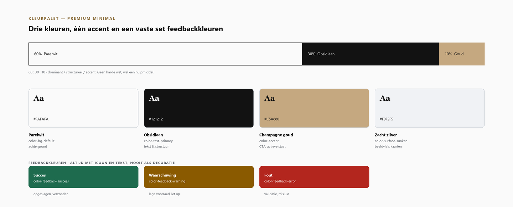
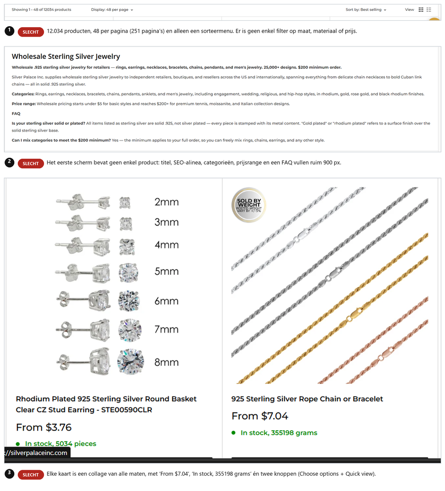
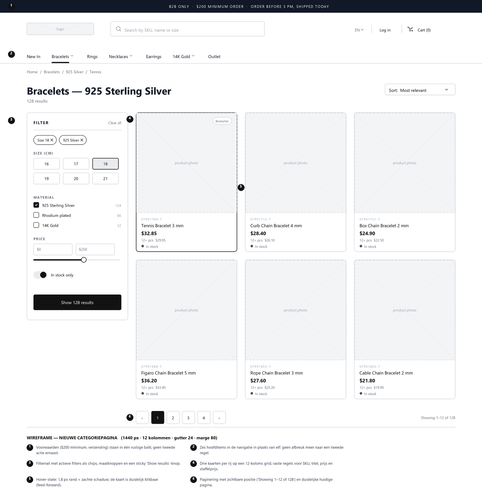
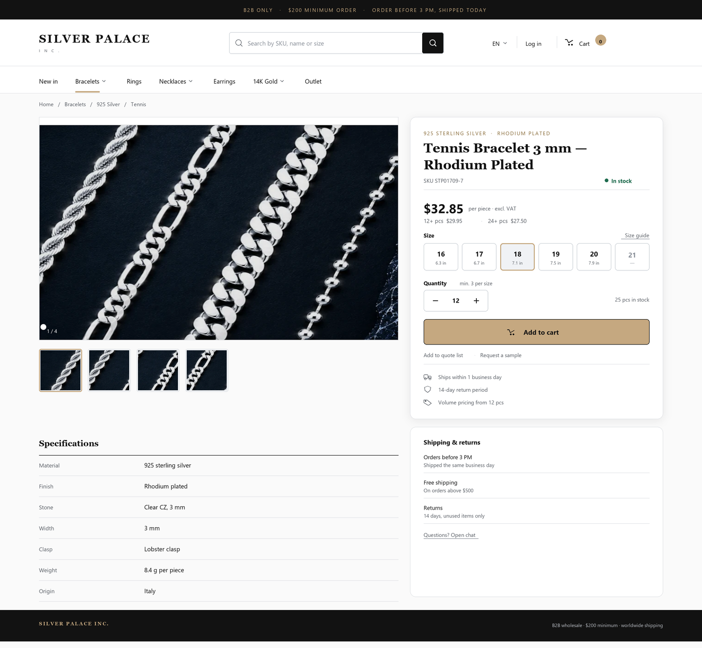
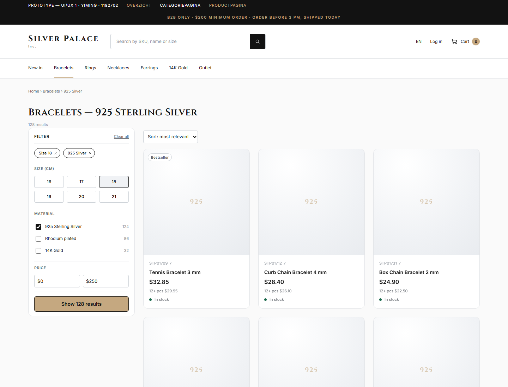
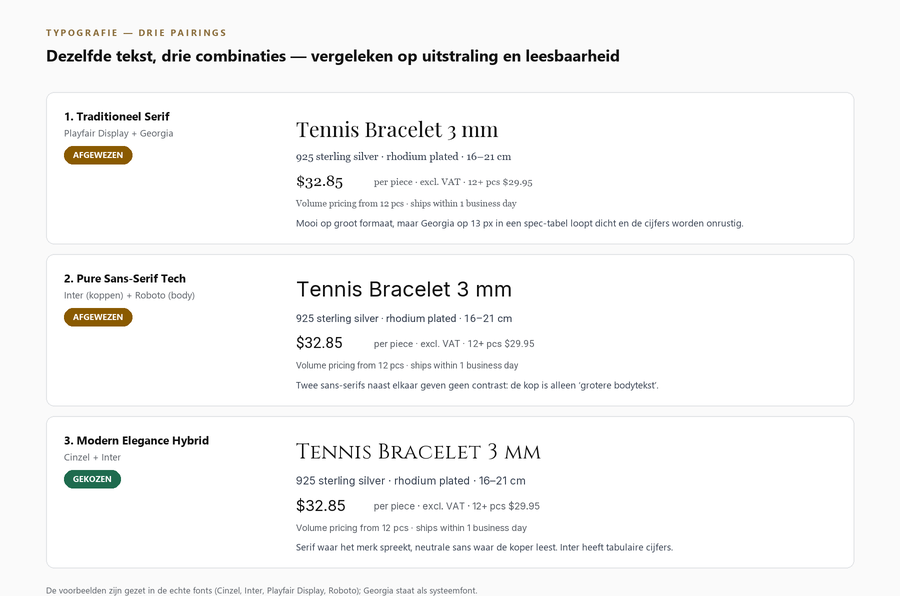

# UI/UX 1 — Website verbeteringen · Silver Palace Inc.

Verbetervoorstel, prototype en video voor de eindopdracht **UI/UX 1** (ROC Nijmegen, jaar 4).

**Yiming Cao · 1192702**

---

## De casus

[SilverPalaceInc.com](https://silverpalaceinc.com) is een internationale B2B-groothandel in 925 sterling
zilver en zirkonia. Ik heb één stuk van de customer journey aangepakt: **van categoriepagina naar
productpagina naar de winkelwagen** — het moment waarop een inkoper moet kunnen filteren, specificeren
en bestellen.

De analyse is gedaan op echte screenshots (viewport 1903 en 1919 px): kleuren bemonsterd per pixel,
contrasten nagerekend volgens de WCAG-formule, verhoudingen opgemeten via cap-hoogtes.

## Wat zit er in deze repository

| Pad | Inhoud |
|---|---|
| [`UIUX Website verbeteringen - compleet.docx`](<UIUX Website verbeteringen - compleet.docx>) | Het einddocument — vijf hoofdstukken, vier figuren, geen tabellen |
| [`Yiming-1192702-eindopdracht-uiux.mp4`](Yiming-1192702-eindopdracht-uiux.mp4) | De video-opname voor de eindopdracht (5:34, 43 MB) |
| [`prototype/`](prototype/) | Werkend prototype in HTML/CSS/JS (drie pagina's, geen framework) |
| [`figuren/`](figuren/) | Alle figuren uit het document als PNG |

## De drie belangrijkste bevindingen

1. **12.034 producten, geen enkel filter.** De categoriepagina biedt alleen sorteren; bij 48 producten
   per pagina zijn dat 251 pagina's bladeren. De kop van de pagina wordt gevuld door SEO-tekst en een
   FAQ — boven de vouw staat geen enkel product.
2. **Kleur zakt voor de norm.** De rode actietekst (`#FF2A00` op wit) haalt **3,76:1** en voldoet
   daarmee niet aan WCAG AA (4,5:1). Het nieuwe palet haalt **17,95:1** voor tekst en **8,28:1** voor
   het label op de gouden knop.
3. **De hiërarchie is te vlak.** De verhouding tussen titel en bodytekst is **1,4 : 1**; de sectiekop
   "Description" is zelfs even groot als de H1. Het voorstel zet dat recht op **2 : 1** met een vaste
   typografische schaal.

## De vier verbetervoorstellen

| # | Onderwerp | Kern |
|---|---|---|
| 1 | **Kleur** | Premium Minimal: parelwit, obsidiaan en één warm accent. Drie richtingen vergeleken, één gekozen, contrast per combinatie nagerekend |
| 2 | **Typografie** | Cinzel voor koppen, Inter voor alles wat functioneel is. Drie pairings op dezelfde criteria vergeleken, met gemeten x-hoogtes |
| 3 | **Layout en grid** | 12-kolomsgrid met een 8-punts spacing-schaal; vier gestaltprincipes geanalyseerd en toegepast |
| 4 | **Interactie** | Zes button-states, feedback op de plek van de klik, en iconen uit één bibliotheek met label |

Daar bovenop een **mini design system**: 13 kleurtokens, 8 typografie-tokens en 8 spacing-waarden,
met twee uitgewerkte componenten (button en productkaart).

## Het prototype

Open [`prototype/index.html`](prototype/index.html) — dubbelklikken is genoeg, er is geen server of
installatie nodig.

- Gebouwd met de hand in HTML, CSS en een klein stukje JavaScript. **Geen Figma, geen AI, geen framework.**
- Elke kleur, afstand en elk corps in `styles.css` staat als CSS-token in `:root`, bovenaan het bestand.
- De fonts (Cinzel en Inter) zitten als subset ingebed in `css/fonts.css`, zodat het ook op `file://` werkt.
- Wat je kunt uitproberen: maat kiezen, aantal onder het minimum zetten (foutmelding), toevoegen aan de
  winkelwagen (loading → bevestiging), en met Tab door de pagina gaan (zichtbare focusring).

## Figuren

| | |
|---|---|
|  |  |
| Het palet met de 60:30:10-verdeling | De categoriepagina: 12.034 producten zonder filter |
|  |  |
| Wireframe van de nieuwe categoriepagina | Mock-up van de nieuwe productpagina |
|  |  |
| Het prototype zoals het in de browser staat | De drie typografie-pairings naast elkaar |

## Bronnen en verantwoording

- Screenshots van silverpalaceinc.com, gebruikt voor educatieve analyse.
- De lespresentaties UI-1 tot en met UI-7 horen bij de opleiding en zijn **niet** in deze repository opgenomen.
- WCAG 2.2 (W3C) voor de contrast- en focusnormen; WebAIM voor de controle van de ratio's.
- De fonts Cinzel en Inter zijn afkomstig uit de Google Fonts-repository en vallen onder de SIL Open Font
  License (OFL).
